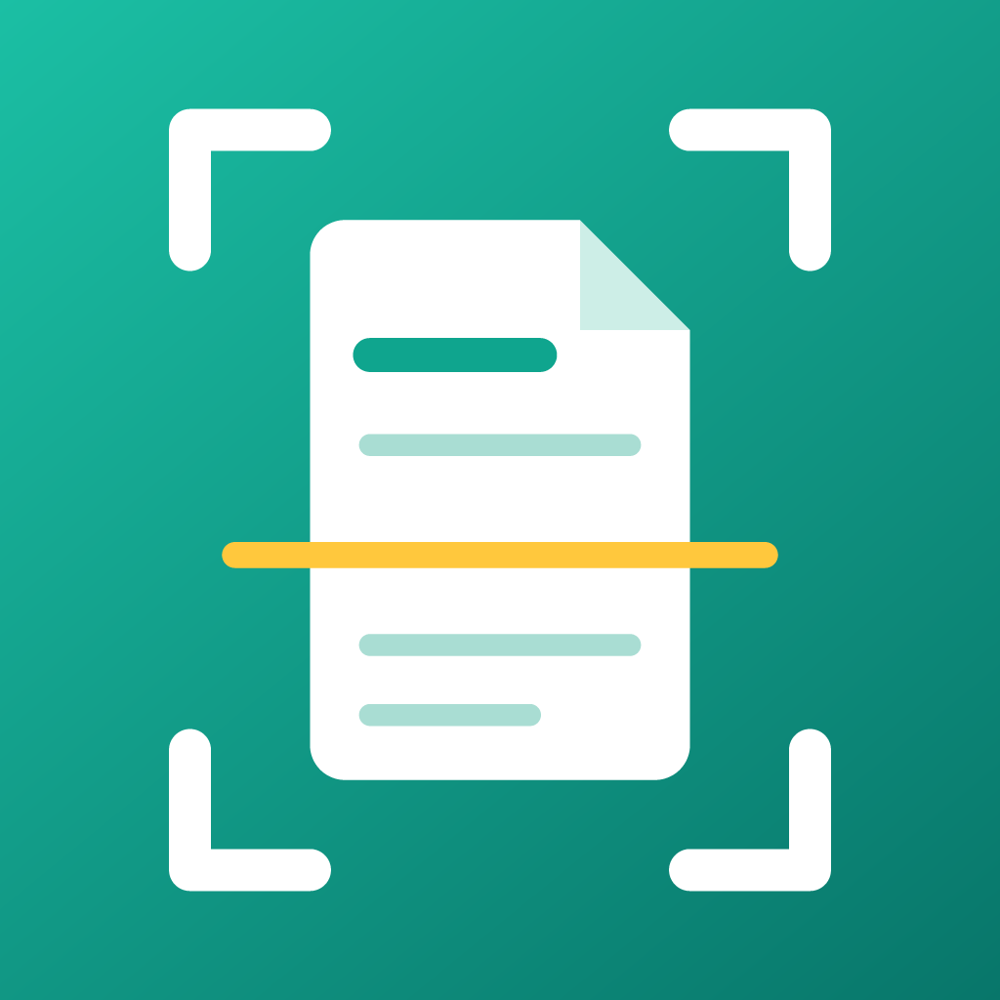
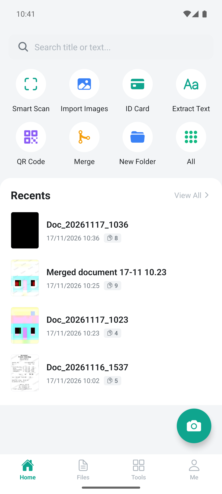
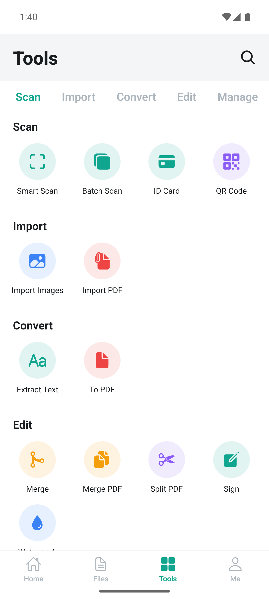
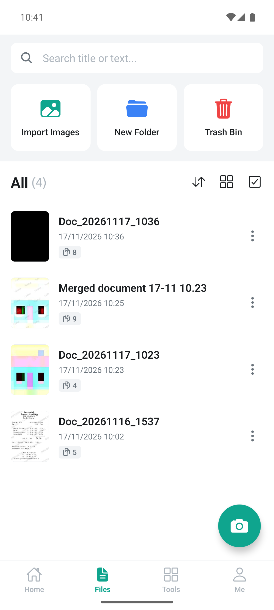
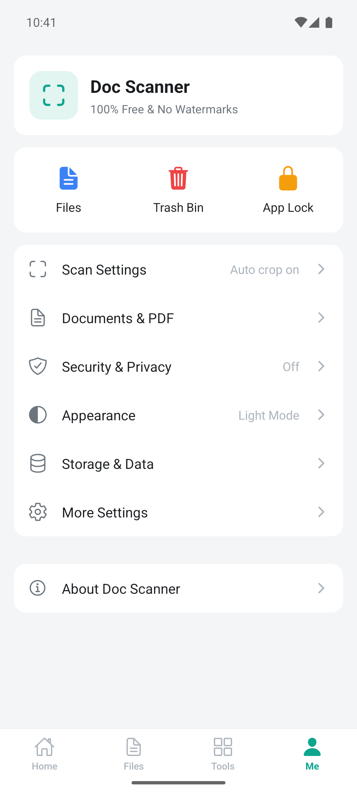

<p align="center">
  
</p>

<h1 align="center">Doc Scanner</h1>

<p align="center">
  Scan receipts, contracts and ID cards into clean, searchable PDFs on your Android phone.<br />
  Free, no watermarks, no account.
</p>

<p align="center">
  <a href="https://github.com/tusar1mran/scanner-landing/releases/download/v1.0.0/doc-scanner.apk"><b>Download APK (v1.0.0, 164 MB)</b></a>
  &nbsp;·&nbsp;
  <a href="https://scannar-landing.vercel.app">Website</a>
  &nbsp;·&nbsp;
  <a href="https://github.com/tusar1mran/scanner-landing/releases">All releases</a>
</p>

<p align="center">
  
  
  
  
</p>

## Features

- **Smart Scan** – detects the page edges and crops automatically (auto crop is on by default).
- **Batch Scan** – capture many pages into one document.
- **ID Card mode** – scan the front and back; both sides are placed on one A4 page.
- **Extract Text** – on-device text recognition (Google ML Kit), works offline.
- **Import Images** – turn gallery photos into scans.
- **To PDF, Merge, Sign, Watermark** – edit and export from the Tools tab.
- **QR Code** – read QR codes with the camera.
- **Files** – folders, sorting, and search by title or by the text inside a scan.
- **Trash Bin** – restore documents you deleted by mistake.
- **App Lock** – lock the app with your phone's biometric or device unlock.

Documents are stored on the phone in the app's local database. No sign-up is needed.

## Install on Android

1. On your phone, open the [download link](https://github.com/tusar1mran/scanner-landing/releases/download/v1.0.0/doc-scanner.apk) and save `doc-scanner.apk`.
2. Open the downloaded file.
3. If Android asks, allow **Install unknown apps** for your browser or file manager (Settings → Apps → Special app access → Install unknown apps).
4. Tap **Install**, then **Open**.

The APK is not from Google Play, so Play Protect may show a warning. Only install it from this repository's Releases page.

## How to use

1. **Scan:** on the Home tab, tap **Smart Scan** (or the camera button). Point at the document; the edges are found and cropped for you. For several pages, use **Batch Scan**.
2. **ID cards:** tap **ID Card**, scan the front, then the back. Both sides are saved on one page.
3. **Get text:** open **Extract Text** to copy the words out of a scan.
4. **Edit:** from the **Tools** tab, merge documents, add a signature or watermark, or convert images to PDF.
5. **Organise:** the **Files** tab lists every scan. Create folders, sort, or search by title or text.
6. **Share:** open a document and tap **PDF** or **Share**.
7. **Protect:** in the **Me** tab, turn on **App Lock**. Deleted files go to the **Trash Bin**, where you can restore them.

## About this repository

This repository holds the landing page at [scannar-landing.vercel.app](https://scannar-landing.vercel.app), built with Next.js 16, Tailwind CSS 4 and GSAP. The Android app's APK is published under [Releases](https://github.com/tusar1mran/scanner-landing/releases).

### Run the website locally

```bash
npm install
npm run dev
```

Open http://localhost:3000.

### Build

```bash
npm run build
npm start
```
